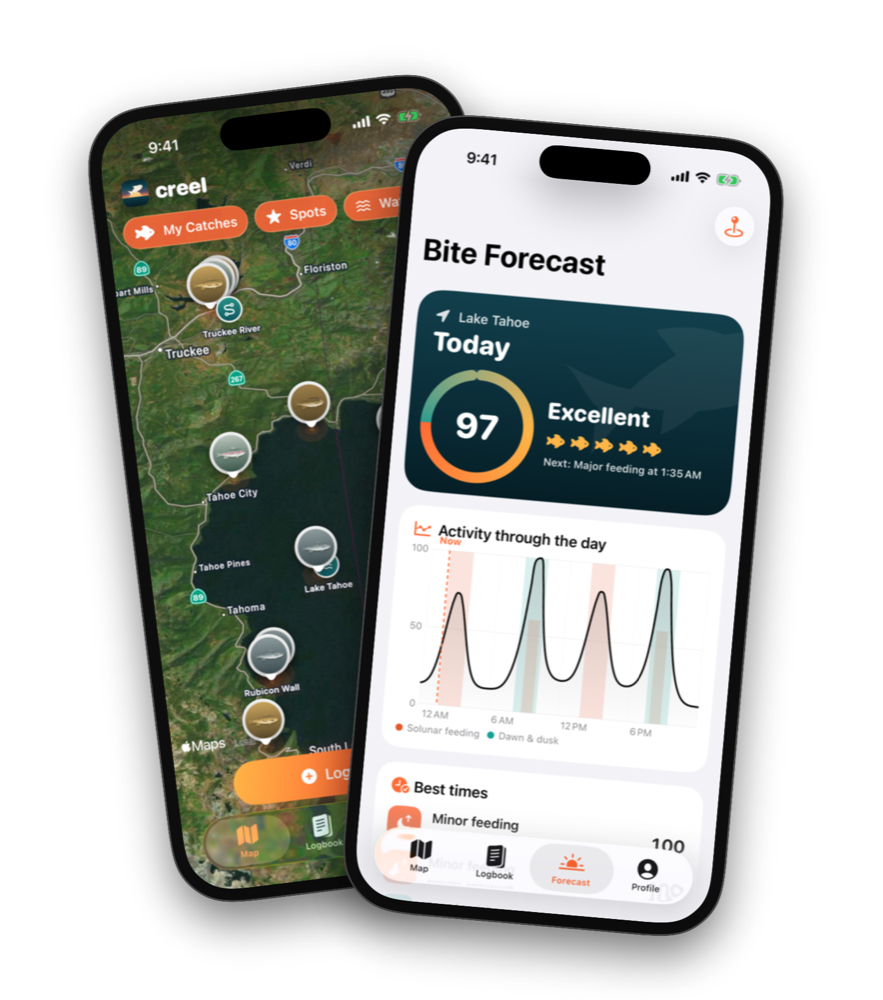
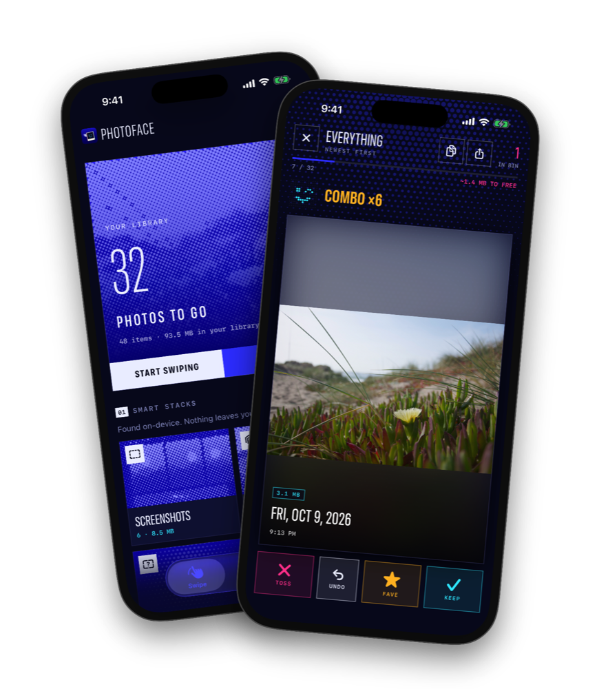
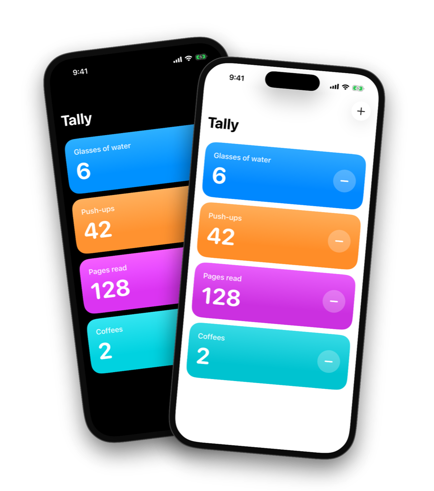

<p align="center">
  <picture>
    <source media="(prefers-color-scheme: dark)" srcset="docs/media/hero-dark.svg">
    
  </picture>
</p>

# mainline

Take an iOS app from idea to TestFlight without opening Xcode.

mainline is a small command-line tool that does every step of shipping a SwiftUI app: it creates the project, builds
and tests it in the simulator, takes screenshots, signs it in Apple's cloud, uploads it, sets up TestFlight, and reads
crash reports. It was built for AI agents. Tell Claude Code (or any coding agent) what you want, and it can go from a
paragraph to a build on your phone on its own, asking you only for the things that need you.

```
$ mainline ship tally
==> Registering bundle ID com.example.tally
    ✓ bundle ID registered
==> Looking up the App Store Connect app record
    ✓ app record 6740000000
==> Testing Tally on the simulator
    ✓ tests passed
==> Choosing the build number
    ✓ version 1.0.0 build 2
==> Archiving (Release, generic iOS device, unsigned)
==> Exporting a signed .ipa
==> Uploading to App Store Connect
    ✓ uploaded build 2
==> Configuring TestFlight
    ✓ group "Internal"
    ✓ tester you@example.com
==> Waiting for App Store Connect to process the build (usually 5–20 min)
    ✓ build 2 is processed and available to the "Internal" group
==> Shipped Tally 1.0.0 (2) in 3m41s
```

## Built with mainline

<table>
  <tr>
    <td width="33%" align="center"></td>
    <td width="33%" align="center"></td>
    <td width="33%" align="center"></td>
  </tr>
  <tr>
    <td align="center" valign="top"><b>Creel</b><br>A fishing log with satellite maps, a solunar bite forecast and a species guide</td>
    <td align="center" valign="top"><b>Photoface</b><br>Swipe through your camera roll, with on-device stacks of screenshots, bursts and blurry shots</td>
    <td align="center" valign="top"><b>Tally</b><br>Counters for anything, and the <a href="examples/tally">example app</a> in this repo</td>
  </tr>
</table>

Each went from a one-paragraph prompt to TestFlight with Claude Code driving mainline: the code, the tests, the brand
and icon, the screenshots it checked its work against, and the crash fixes after real use.

## Why it works headless

- **No project files to babysit.** Each app is a short `project.yml` and an `app.env`. The Xcode project is generated
  before every command, so it can't drift, and an agent never edits one.
- **No certificates.** Builds are archived unsigned and signed at export with Apple's cloud-managed certificate and an
  App Store Connect API key. Nothing touches your keychain, so it works the same over SSH.
- **Apple's API for the rest.** Bundle IDs, build numbers, TestFlight groups and testers, processing, crash reports.
  The one thing Apple's API can't do, creating an app's store record, is a single form per app, and `mainline` prints
  every value for it.
- **Made to be read by agents.** One exit code per failure mode, quiet output that shows only the error lines, a
  screenshot path the agent can open, and a playbook (`mainline guide`) that ships with the tool.

[How it works](docs/how-it-works.md) has the details, including why there's no fastlane.

## Quick start

You need a Mac with [Xcode](https://apps.apple.com/app/xcode/id497799835) and [Homebrew](https://brew.sh).

```sh
brew install xcodegen jq
git clone https://github.com/ztaylor/mainline ~/mainline
ln -s ~/mainline/bin/mainline /usr/local/bin/mainline

mainline doctor                              # what's missing?
mainline test tally                          # the example app's tests, in the simulator
mainline run tally -- -seed-sample-data      # launch it and take a screenshot
```

That much needs no Apple account. To ship, join the [Apple Developer Program](https://developer.apple.com/programs/),
then follow [setup](docs/setup.md) to create an API key and save your settings:

```sh
mainline setup --team ABCDE12345 --prefix com.yourname --tester you@example.com
mainline setup --key ~/Downloads/AuthKey_ABC123DEFG.p8 --issuer <issuer-id>
```

Then create your first app. It's a self-contained folder that can live anywhere, as its own repo; mainline is just
the tool you run on it:

```sh
cd ~/code
mainline new habit-streaks --name "Habit Streaks" --symbol flame.fill --from "#FF9F1C" --to "#E71D36"
cd habit-streaks && git init
mainline test
mainline ship
```

Rather keep several apps in one repo? `mainline init my-apps` makes a workspace with an `apps/` folder, and
`mainline new` puts apps there.

The [playbook](docs/playbook.md) walks through every step.

## With an agent

In Claude Code, install the plugin:

```
/plugin marketplace add ztaylor/mainline
/plugin install mainline@mainline
```

Then just ask:

> Make me an iPhone app for tracking which houseplants I've watered, with reminders. Make it look great, and ship it to TestFlight.

Claude reads the playbook from `mainline guide`, then builds, tests, screenshots, fixes, and ships. If [Claude in Chrome](https://claude.com/chrome)
is connected, it also fills in the App Store Connect form. It never types your passwords; 2FA prompts and Apple's
agreements stay with you. For Codex, Cursor and other agents, `mainline init` writes an `AGENTS.md` that does the same
job. [Agents](docs/agents.md) covers permissions, the browser step, and working over SSH.

## Commands

| | |
| --- | --- |
| `setup` · `doctor` · `init` · `new` · `list` · `guide` | Set up, check, and create apps |
| `build` · `test` · `run` · `screenshots` · `icon` · `gen` | Develop in the simulator |
| `register` · `ship` · `status` · `crashes` · `asc` | Release to TestFlight |

`mainline help` lists every option, and the [command reference](docs/commands.md) has the details, exit codes and settings.

## Docs

- [Setup](docs/setup.md): your Mac and your Apple account, once
- [Playbook](docs/playbook.md): idea → TestFlight, step by step
- [Agents](docs/agents.md): Claude Code, other agents, permissions, the browser step
- [How it works](docs/how-it-works.md): generated projects, cloud signing, the one web step
- [Commands](docs/commands.md): every command, setting and file
- [Web steps](docs/web-steps.md): the three things that happen in a browser
- [Troubleshooting](docs/troubleshooting.md): errors you might see, and their fixes
- [Agent guide](docs/agent-guide.md): what your agent reads, including the SwiftUI pitfalls we hit so it doesn't

## What's here

| | |
| --- | --- |
| [`bin/mainline`](bin/mainline), [`lib/`](lib) | The CLI, in bash 3.2 so it runs on any Mac as is |
| [`tools/MainlineTools`](tools/MainlineTools) | `asc`, an App Store Connect API client, and `appicon`, an icon renderer. Swift, no dependencies, built on first use. |
| [`templates/app`](templates/app) | What `mainline new` starts from: SwiftUI, SwiftData, Swift Testing, XCTest UI tests |
| [`examples/tally`](examples/tally) | A complete example app |
| [`plugins/mainline`](plugins/mainline) | The Claude Code plugin |
| [`docs`](docs) | The guides above. [`docs/media`](docs/media) is made by [`tools/media`](tools/media). |

## Requirements

macOS with Xcode 26 or later, [XcodeGen](https://github.com/yonaskolb/XcodeGen) and [jq](https://jqlang.org). Shipping
needs a paid Apple Developer Program membership and an App Store Connect API key with the Admin role. Apps built from the
template run on iOS 18 and later.

## License

MIT. See [LICENSE](LICENSE).

mainline is an independent project, not affiliated with Apple. Xcode, TestFlight and App Store Connect are trademarks of Apple Inc.
